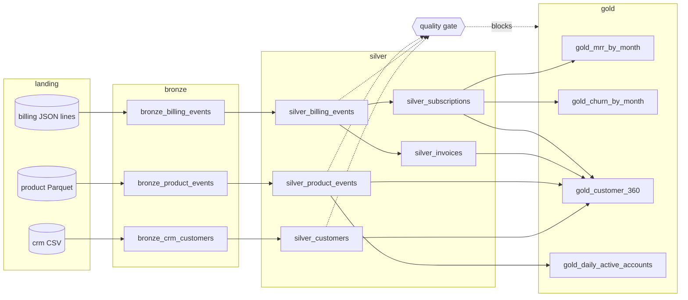

# mini-lakehouse

A small data platform built the way a data team structures ingestion to reporting, on a laptop with DuckDB. Three synthetic sources for a made-up subscription business (Larkspur Analytics) land as daily files: a CRM export (CSV), a billing system (JSON lines), and a product event stream (Parquet). A pipeline moves them through bronze (raw, append-only), silver (typed, deduplicated, conformed), and gold (MRR, churn, customer 360, daily active accounts). Models are SQL files with `{{ ref() }}` calls, a small dbt-like runner builds the DAG and runs it, quality tests gate promotion to gold, and every run is logged to a table and exported as a lineage page.

## Why

Most reporting bugs are pipeline bugs. A duplicated billing event inflates revenue, a renamed field turns amounts into nulls, a late event lands in the wrong day, and a rerun after a failure double counts. Teams solve this with the same few patterns: keep raw data immutable, make every load idempotent, merge late data by key, test data between layers, and refuse to publish reports when the tests fail. This project shows those patterns working end to end, with numbers you can check.

## Architecture



| Piece | File | What it does |
|---|---|---|
| Source generator | `src/minilakehouse/generate.py` | Seeded synthetic data. Billing has late events (about 6%), duplicates (about 4%), and renames `amount_cents` to `amount_minor` on day 4. Day 1 carries six months of opening history. |
| Bronze | `bronze.py` | One batch per landing file. Adds `_source_file`, `_loaded_at`, `_batch_id`, `_batch_seq`, `_partition_date`. A file manifest with SHA-256 hashes makes reloading a no-op. New columns are added and logged in `_schema_changes`. |
| Models | `models/silver/*.sql`, `models/gold/*.sql` | SQL with a TOML header for materialization and tests. `{{ ref('x') }}` declares dependencies. |
| DAG | `dag.py` | Parses refs, checks layer order, topological sort with cycle detection, `--select model+`, `+model`, `layer:silver`. |
| Runner | `runner.py` | Builds layer by layer, runs tests after each layer, blocks gold if a silver test fails, logs every model to `_run_log`. |
| Quality | `quality.py` | `not_null`, `unique`, `accepted_values`, `relationships`, `freshness`, `row_count_anomaly` (vs the previous successful run). Severity `error` blocks, `warn` reports. |
| Lineage | `lineage.py` | Writes `docs/lineage.mmd` and `docs/lineage.html` with the DAG and latest stats per model. |

Incremental silver models keep a watermark per model (the highest bronze batch they have read). Each run reads only newer batches and merges by unique key: `ignore` for immutable events (first delivery wins, so duplicates vanish) and `update_if_newer:updated_at` for CRM rows. Late events go to the partition of their event date. Schema drift is handled in SQL with `{{ any_of('bronze_billing_events', 'amount_minor', 'amount_cents') }}`, which expands to a `COALESCE` over whichever columns exist.

Metadata tables in the warehouse: `_bronze_manifest`, `_schema_changes`, `_model_state`, `_runs`, `_run_log` (run id, model, rows, rows written, partitions, duration, status, fingerprint), `_test_results`.

## How to run

```bash
cd mini-lakehouse
uv sync --python 3.12

uv run minilakehouse generate --days 7            # landing files under ./lakehouse/landing
uv run minilakehouse run --through 2026-11-01     # days 1 to 6
uv run minilakehouse run --through 2026-11-01     # same days again: nothing changes
uv run minilakehouse run                          # day 7 only
uv run minilakehouse run --select silver_invoices+
uv run minilakehouse backfill --from 2026-10-30 --to 2026-10-31
uv run minilakehouse test
uv run minilakehouse lineage                      # docs/lineage.mmd and docs/lineage.html
uv run minilakehouse ls                           # models in run order
uv run minilakehouse runs                         # recent rows of _run_log
```

`make demo` runs the whole incremental sequence. `make gate-demo` generates a bad last day and shows the gate stop gold. Data lives in `./lakehouse` by default (set `MINILAKEHOUSE_HOME` or `--home` to change it). To open the lineage page with the rendered diagram, serve the folder: `python -m http.server -d docs` and visit `/lineage.html`.

### What the numbers look like

From `make demo` (seed 7). `written` is rows inserted or updated by this run. `data` compares the table's content hash with its last successful build.

Days 1 to 6, then the same command again:

```
model                        status      rows  written  data     partitions touched
silver_billing_events        success      529      529  new      2026-04-30..2026-11-01 (135)
silver_product_events        success     2208     2208  new      2026-10-27..2026-11-01 (6)
gold_mrr_by_month            success        8        8  new      -
...rerun...
bronze_billing_events        success      531        0  same     -
silver_billing_events        success      529        0  same     -
silver_product_events        success     2208        0  same     -
gold_mrr_by_month            success        8        0  same     -
```

Day 7 only touches the 2026-11-02 partition: 515 new product events in bronze, 509 after removing 6 repeats, 14 billing events, 8 changed CRM rows out of 146. A backfill of 2026-10-30 to 2026-10-31 rewrites those two partitions and every table's hash stays `same`.

With `--corrupt-last-day`, two billing events reference customer `C99999` and one has event type `invoice_refunded_v2`. The run ends with:

```
gold_mrr_by_month            gold    blocked        8        0  kept
tests: 31 passed, 2 failed, 0 warnings
GATE FAILED: gold was not promoted. The previous gold tables are unchanged.
Why:
  - silver_billing_events.accepted_values(event_type): 1 row with unexpected event_type: invoice_refunded_v2
  - silver_billing_events.relationships(customer_id -> silver_customers.customer_id): 2 rows point to missing silver_customers.customer_id: C99999
```

and exits with code 1, so a scheduler marks the run failed.

## Tests

47 tests, run with `uv run pytest -q` (about 20 seconds).

- DAG (15): ref parsing, TOML config, layer inference, topological order, stable tie breaks, cycle detection with the cycle path, unknown refs, layer order violations, duplicate names, `model+`, `+model`, `layer:` and comma selection.
- Quality (11): each test type passing and failing, `where` filters, freshness on an empty table, row-count anomaly against the run log, `warn` not blocking, unknown test types and bad columns reported as errors.
- Pipeline (17): bronze load metadata, idempotent rerun (0 rows written and identical hashes), a new day touching only its partition, a late event merged into its event date and not reloaded twice, duplicates removed, schema drift logged and conformed, `any_of` before the drift, a failing gate blocking gold with gold hashes unchanged, a model error skipping downstream, `--select silver_invoices+`, backfill leaving data unchanged, a corrected re-delivery replacing its batch, the `test` command, lineage export, and the CLI end to end including a nonzero exit on a bad day.
- Metrics (4): MRR, new MRR, churned MRR, and logo churn on three hand-written subscriptions, MRR moves reconciling month to month, and the `as_of` cutoff.

`uv run ruff check .` is clean.

## DevOps

- `.github/workflows/ci.yml`: ruff and pytest, then a pipeline job that generates 7 days, runs days 1 to 6, reruns them, runs day 7, runs the quality tests, and uploads the lineage page as an artifact. A third job builds the Docker image.
- `.github/workflows/nightly.yml`: an example orchestrated run on a cron schedule (06:15 UTC), with an optional manual backfill range, a concurrency group so two runs never overlap, and the lineage page uploaded even when the run fails.
- `Dockerfile`: two-stage build on `python:3.12-slim`, non-root user, data on a `/data` volume. It is a batch job, so the entrypoint runs the CLI and exits with the run status.
- `Makefile`: `install`, `test`, `lint`, `run`, `demo`, `gate-demo`, `lineage`, `clean`.

Docker is not installed on the machine this was built on, so the image and both workflows are built and run in GitHub Actions only. Everything runs without Docker through `uv run`.

## Production notes

- Storage: landing and bronze would be object storage (S3 or GCS) with tables in Apache Iceberg or Delta Lake, which give the same append, merge, and schema evolution on files with snapshots and time travel.
- Transformations: the SQL models and runner map to dbt (`ref`, incremental models with `unique_key`, `--select model+`, and `dbt test`).
- Orchestration: the nightly workflow would be an Airflow DAG or Dagster job with per-partition runs, retries, and backfills as first-class operations.
- Data quality: the declared tests map to dbt tests or Great Expectations suites, with results sent to an alerting channel and failed batches quarantined instead of merged.
- Gold promotion: here a failed gate leaves the old gold tables in place. At scale this would be write-audit-publish: build gold on an Iceberg branch, test it, and fast-forward only on success.
- Observability and lineage: `_run_log` would feed a metrics store and dashboards, and lineage would come from OpenLineage events into a catalog such as DataHub or Marquez, with column-level lineage parsed from the SQL.

## License

MIT. See [LICENSE](LICENSE).
